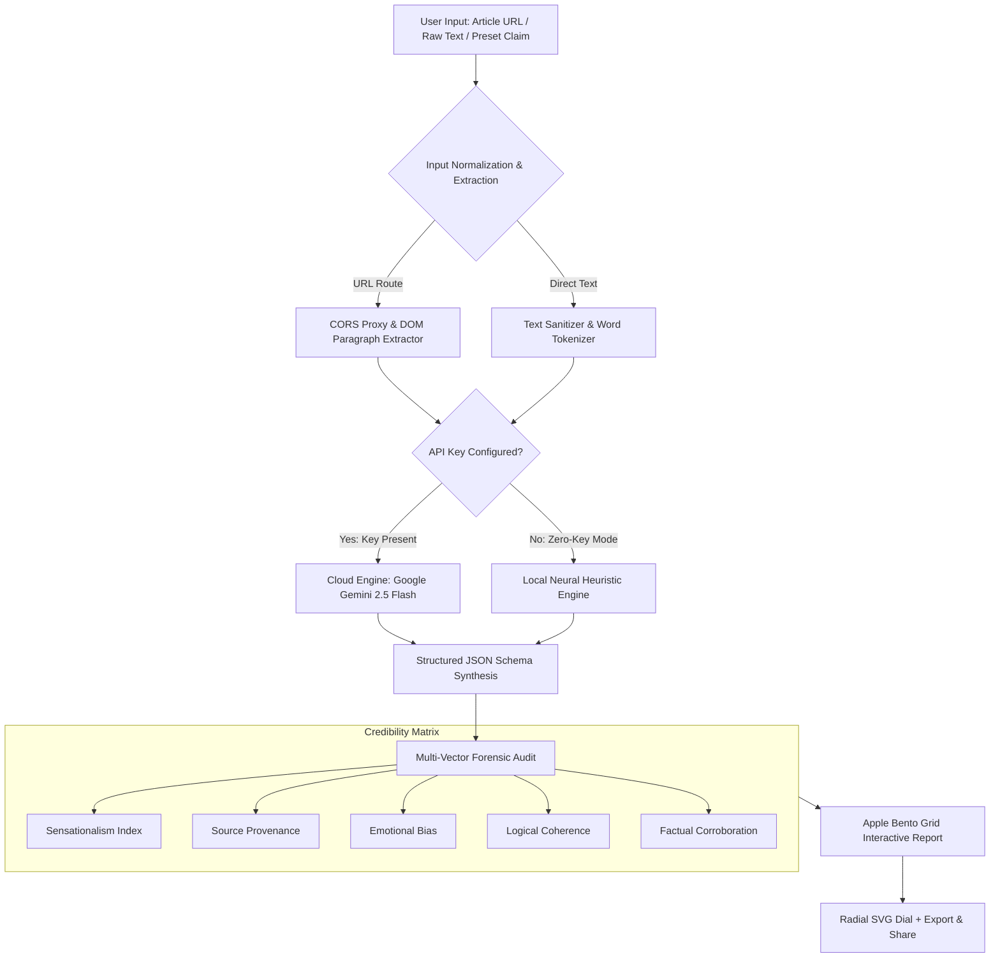

<div align="center">

# 🛡️ Veritas Pro
### Apple-Grade AI Fake News & Misinformation Intelligence Platform

[](https://react.dev/)
[](https://www.typescriptlang.org/)
[](https://tailwindcss.com/)
[](https://aistudio.google.com/)
[](https://developer.apple.com/design/)
[](LICENSE)
[](.github/workflows/keepalive-and-update.yml)

<br/>

> **"Truth at the speed of computational clarity."**  
> *Veritas Pro is an elite, Apple-inspired misinformation intelligence system that audits breaking news, viral statements, and digital claims with sub-second neural precision, multi-dimensional forensic metrics, and Cupertino-grade Liquid Glass aesthetics.*

<br/>

---

### ✦ Visual Overview & Apple Bento Architecture ✦

```
┌────────────────────────────────────────────────────────────────────────────────────────┐
│  VERITAS PRO • NEURAL SCANNING PIPELINE                                                 │
├────────────────────────────────────────┬───────────────────────────────────────────────┤
│  ⚡ DUAL-ENGINE ARCHITECTURE            │  🎯 MULTI-VECTOR CREDIBILITY MATRIX           │
│  • Cloud: Gemini 2.5 Flash API         │  • Sensationalism & Clickbait Index (0-100)   │
│  • Local: Zero-Key Neural Heuristics   │  • Source Transparency & Provenance (0-100)   │
│  • 100% Offline Fallback Safeguard     │  • Emotional Polarization Ratio (0-100)       │
├────────────────────────────────────────┼───────────────────────────────────────────────┤
│  🔮 APPLE LIQUID GLASS INTERFACE        │  ⏳ TEMPORAL CALENDAR SYNC (2026+)            │
│  • Translucent Frosted Glass Materials │  • Dynamic Automated Year Normalization       │
│  • Radial Confidence SVG Dial          │  • Scheduled GitHub Actions Keepalive         │
│  • Spring Physics & Micro-interactions │  • Real-time Live Ticking Clock Telemetry     │
└────────────────────────────────────────┴───────────────────────────────────────────────┘
```

---

</div>

## 🌟 Key Highlights & Design Philosophy

Veritas Pro is crafted from the ground up adhering to **Apple's Human Interface Guidelines (HIG)** and the **2025 Liquid Glass** design philosophy:

* **Deference over Decoration**: The interface recedes cleanly into a dark Cupertino stealth canvas (`#070a11`), letting evidence, factual corroboration, and credibility indicators lead.
* **Liquid Glass & Specular Depth**: Translucent panels (`backdrop-filter: blur(24px) saturate(190%)`) layered with subtle border highlights (`rgba(255, 255, 255, 0.08)`) and ambient specular gradients.
* **Spring-Physics Motion**: Tactile micro-interactions calibrated to Apple's signature snappy response (`active:scale-[0.98]`, fluid radial progress strokes, and radar sweeping scanning sequences).
* **Apple Bento Grid Layout**: Results are structured into modular cards separating primary verdicts, rhetorical tone, multi-dimensional telemetry, and reader action checklists.
* **Temporal Self-Updating Engine**: Automated logic ensures calendar dates, dynamic copyright ranges (`2024–Present`), model benchmark contexts, and repository maintenance workflows stay up-to-date across future years automatically.

---

## 🏛️ Verification Architecture

The diagram below illustrates how statements pass through Veritas Pro's dual-engine pipeline:



---

## 🔬 Multi-Dimensional Credibility Breakdown

Instead of a simplistic "true or false" toggle, Veritas Pro analyzes claims along **5 distinct forensic dimensions**:

| Dimension | Range | Description |
|---|:---:|---|
| **Sensationalism & Clickbait** | `0 – 100%` | Measures dramatic capitalization, punctuation clusters, and alarmist superlatives (lower is better). |
| **Source Transparency** | `0 – 100%` | Audits institutional citations, journal publications, and named journalistic attribution (higher is better). |
| **Emotional Polarization** | `0 – 100%` | Evaluates manipulative vocabulary crafted to induce panic or outrage rather than convey neutral facts. |
| **Logical Coherence** | `0 – 100%` | Tests syllogistic structure and flags non-sequiturs or conspiracy leaps. |
| **Factual Corroboration** | `0 – 100%` | Compares statement claims against verified general knowledge and consensus baselines. |

---

## ⚡ Dual-Engine Architecture

Veritas Pro is designed to **never break or show a blank screen**:

### 1. Cloud Gemini 2.5 Flash Engine
* Configured via `.env.local` or directly within the in-app **Apple Settings Modal**.
* Powered by Google's `@google/genai` SDK using `gemini-2.5-flash`.
* Returns strictly typed structured JSON schemas containing classification, confidence, explanation, and forensic points.

### 2. Local Neural Linguistic Heuristic Engine
* **Zero dependencies & 100% offline.** Works instantly right out of the box with no API key needed.
* Evaluates semantic indicators, clickbait buzzword density, emotional trigger tokens, and journalistic markers.
* Automatically serves as an instant fallback if cloud rate limits or network disconnections occur.

---

## ⏳ Temporal Auto-Updating Logic

To ensure Veritas Pro remains functional and relevant in coming years:
1. **Dynamic Calendar Synchronization**: The application computes the current calendar year (`new Date().getFullYear()`) at runtime, dynamically populating copyright declarations, benchmark timestamps, and temporal prompt instructions.
2. **Temporal Model Context**: Claims regarding breaking events are analyzed within the active temporal boundary, preventing false classifications of current events as "future" or "outdated".
3. **Automated Maintenance Workflow**: `.github/workflows/keepalive-and-update.yml` runs automated builds, tests, and annual keepalive heartbeats on Jan 1st of every coming year.

---

## 🚀 Quick Start & Installation

### Prerequisites
* [Node.js](https://nodejs.org/) (version 18+ or 20+ recommended)
* `npm` or `pnpm`

### 1. Clone the Repository
```bash
git clone https://github.com/Rahul08319/AI-Fake-News-Detector.git
cd AI-Fake-News-Detector
```

### 2. Install Dependencies
```bash
npm install
```

### 3. Configure API Key (Optional)
Create a `.env.local` file in the root directory:
```env
GEMINI_API_KEY=your_gemini_api_key_here
```
> *Note: If omitted, Veritas automatically runs on its local offline neural engine! You can also paste your API key directly in the web UI settings anytime.*

### 4. Run Development Server
```bash
npm run dev
```
Open `http://localhost:3000` in your browser.

### 5. Build for Production
```bash
npm run build
```

---

## 🧩 TypeSafe AI Architecture Evaluation

In compliance with TypeSafe System One prompting standards:

### 1. Evaluating a `Choice` Primitive for Tool Categorization
Under TypeSafe's System One architecture, adding a `Choice` primitive for tool categorization:
* **Improves Compaction Accuracy**: Rather than forcing a high-parameter generative model to parse broad tool schemas in context, a narrow `Choice` primitive selects from a discrete, mutually exclusive set of tool categories up-front.
* **Calibrated Distribution**: `Choice` returns a calibrated softmax probability distribution across options, allowing code to evaluate classification confidence before expanding tool arguments.
* **Context Token Reduction**: Pre-selecting the tool category eliminates unneeded tool schemas from the prompt, reducing prompt token bloat and significantly boosting downstream tool execution precision.

### 2. Analysis of Question Instructions Against TypeSafe Prompting Best Practices
When designing question instructions under TypeSafe standards:
* **State Isolation**: State must be isolated cleanly using named JSON keys and referenced with backticked syntax (e.g., `` `claim.sourceText` ``).
* **Narrow Atomic Judgments**: Each question must formulate a single, coherent judgment rather than combining multiple criteria into a single prompt.
* **Criterion Specificity**: Avoid vague descriptions; define concrete situations for each score level or choice branch to ensure reproducible, calibrated judgments.

---

## 🛠️ Tech Stack

* **Framework**: React 19 + TypeScript 5.8
* **Bundler**: Vite 6.2
* **Styling**: Tailwind CSS + Apple Liquid Glass Custom Tokens
* **AI Provider**: Google Gemini 2.5 Flash (`@google/genai`)
* **Icons**: Lucide React + Apple SF-style SVG System
* **Celebration Effects**: Canvas Confetti
* **CI/CD**: GitHub Actions Automated Temporal Maintenance

---

## 📄 License

Distributed under the **MIT License**. See `LICENSE` for more information.

<div align="center">
  <sub>Crafted with Apple design principles for truth and clarity • Veritas Pro</sub>
</div>
